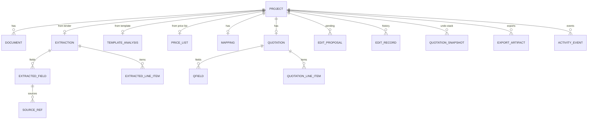

# Data model

Source of truth: `backend/app/models.py` (Pydantic v2, `extra="forbid"`). The TypeScript mirror is
`frontend/src/api/types.ts`. Conventions: IDs are `<prefix>_<12 hex>`; datetimes are timezone-aware UTC ISO strings;
money and quantities are `Decimal`, serialised as strings; optional values are `null`, never empty placeholders.

## Project / workspace — `Project` (`projects/<id>/project.json`)

| Field | Type | Notes |
|---|---|---|
| `id` | `prj_…` | generated |
| `name` | string ≤ 120 | user-editable; defaults to the tender title after upload |
| `is_sample` | bool | true for the fictional demo project |
| `created_at`, `updated_at` | datetime | |
| `documents` | `DocumentRecord[]` | at most one per role |
| `extraction` | `Extraction \| null` | from the tender |
| `template` | `TemplateAnalysis \| null` | from the template |
| `price_list` | `PriceList \| null` | optional |
| `mapping` | `Mapping \| null` | created with the template |
| `company` | `CompanyProfile \| null` | per-project profile; only the sample project sets one (fictional). `null` → Settings → Company profile is used |
| `quotation` | `Quotation \| null` | after generation |
| `pending_edits` | `EditProposal[]` | at most one pending at a time |
| `edit_history` | `EditRecord[]` | |
| `undo_stack` | `QuotationSnapshot[]` | max 30 |
| `exports` | `ExportArtifact[]` | |
| `events` | `ActivityEvent[]` | max 200 |

## Uploaded document — `DocumentRecord`

`id` (`doc_…`), `role` (`tender|template|price_list`), `filename` (sanitised, display only), `format`
(`pdf|docx|xlsx|csv`), `size_bytes`, `sha256`, `uploaded_at`, `parse_status` (`parsed|failed`), `parse_error`,
`page_count` (PDF only), `block_count` (text blocks; for templates: fill-in fields), `table_count`, `warnings[]`.
Stored file: `uploads/<id>.<format>`.

## Source reference — `SourceRef`

`document_id`, `document_name`, `block_id`, `page`, `line`, `paragraph`, `table`, `row`, `column`, `sheet`, `cell`,
`snippet` (verbatim block text, ≤ 300 chars), `precision` (`exact|block|unavailable`). All positions are 1-based.
Unknown parts stay `null`; the UI shows "Location unavailable" rather than inventing one.

| Block ID | Meaning |
|---|---|
| `p3-l7` | PDF page 3, paragraph starting on line 7 |
| `p3-t1-r4` | PDF page 3, table 1 (page-local), row 4 |
| `para-12` | DOCX body paragraph 12 |
| `t2-r4` | DOCX table 2 (document-wide), row 4 |
| `s1-r5` | XLSX sheet 1, row 5 (cell references are stored per cell) |
| `csv-r5` | CSV row 5 |

## Extracted field — `ExtractedField`

| Field | Type | Notes |
|---|---|---|
| `key`, `label` | string | one of 16 specs in `extraction/rules.py` |
| `section` | `overview|dates|commercial|delivery|eligibility` | |
| `value` | string \| null | `null` when missing **or in conflict** |
| `normalized` | string \| null | ISO date/time, days, or ISO currency code |
| `status` | `extracted|needs_review|conflict|missing|confirmed|edited` | review labels, not probabilities |
| `sources` | `SourceRef[]` | |
| `candidates` | `{value, source}[]` | for conflicts |
| `note`, `rule`, `required` | | `rule` names the matching rule for transparency |

`ExtractedLineItem`: `id` (`itm_…`), `item_no`, `description`, `quantity` (Decimal \| null), `quantity_text` (as
written), `unit`, `specification`, `status`, `source`, `notes[]`. `Requirement`: `id`, `category`
(`eligibility|technical|submission|commercial|delivery|other`), `text`, `source`, `acknowledged`. `SuspiciousText`:
`id`, `text`, `pattern`, `source` — instruction-like text, kept as data only.

`Extraction`: `document_id`, `engine` (always `rules` in 0.1.0), `fields[]`, `line_items[]`, `requirements[]`,
`suspicious_text[]`, `warnings[]`, `reviewed`, `reviewed_at`, `created_at`, `updated_at`.

## Price list — `PriceList` (optional, user supplied)

`document_id`, `document_name`, `rows: {row, name, unit_price (Decimal), unit, currency}[]`, `warnings[]`. Rows
without a parseable price are skipped with a warning. Matching rules live in `app/pricing.py`: the same set of words
→ exact match (price confirmed); at least 75 % of the shorter name's words shared, and at least 2 shared words unless a
name has only one → partial match (price needs confirmation); two equally good rows → ambiguous, no price.

## Quotation template — `TemplateAnalysis`

`document_id`, `document_name`, `format` (`docx|xlsx`), `fields: TemplateField[]`, `items_table: ItemsTableInfo|null`,
`warnings[]`.

- `TemplateField`: `id` (`ph:<key>` for placeholders, `lbl:paragraphN` / `lbl:tTrRcC` / `lbl:Sheet!B4` for label
  blanks), `key` (canonical key or null), `label`, `kind` (`placeholder|label_blank`), `required`, `recognized`,
  `locations[]`.
- `ItemsTableInfo`: `location`, `table_index` (DOCX, 0-based) or `sheet` (XLSX), `header_row`, `template_row`
  (0-based rows for DOCX, 1-based sheet rows for XLSX), `columns: {index, header, attribute}[]`, `mode`
  (`header_detected|placeholder_row`).

## Field mapping — `Mapping`

`fields: {target_field_id, source_key|null, status: auto|manual|unmapped}[]` (one row per destination),
`columns: {column_index, attribute|null, status}[]`, `confirmed`, `confirmed_at`. Any change sets `confirmed=false`.
`MappingView` (API only) adds `sources` (every quotation field with current value and origin), `template_fields`,
`items_columns`, `unmapped_sources`, `unfilled_targets`, `required_unfilled`.

## Quotation — `Quotation`

| Field | Type | Notes |
|---|---|---|
| `id`, `version` | string, int | version increments on every change; proposals are bound to it |
| `fields` | `Record<key, QField>` | 27 canonical keys (see `fields.py`) |
| `line_items` | `QuotationLineItem[]` | |
| `currency`, `currency_origin` | ISO code \| null | only from Settings or the user |
| `tax`, `tax_origin` | `{enabled, label, rate}` | rate is a percentage `Decimal` 0–100 |
| `subtotal`, `tax_amount`, `total` | Decimal \| null | null while any line amount is unknown |
| `acknowledged_issue_ids` | string[] | warnings the user acknowledged |
| `source_versions` | map | inputs used, for stale-draft detection |
| `generated_at`, `updated_at` | datetime | |

`QField`: `key`, `label`, `value`, `origin` (`extracted|user|calculated|price_list|company_profile|settings|ai_suggestion|missing`),
`source`, `confirmed`, `note`.

## Quotation line item — `QuotationLineItem`

`id`, `item_no` (renumbered 1..n), `description`, `specification`, `quantity`, `unit`, `unit_price`, `amount`
(calculated or override), `amount_override`, `origins` (per attribute), `source` (tender row), `price_note`
(e.g. price-list row and match type), `price_confirmed`, `reviewed`, `tender_line_id`, `tender_quantity`.
Constraint: `amount = round_half_up(quantity × unit_price, 2)` unless `amount_override` is set (then validation compares).

## Validation issue — `ValidationIssue`

`id` (`<rule>:<target>`, stable across runs), `rule`, `severity` (`error|warning|info`), `title`, `message`,
`section`, `field_key`, `line_item_id`, `suggestion`, `acknowledgeable` (warnings only), `acknowledged`, `fix`
(quick-fix id: `confirm_mapping`, `set_currency:XXX`, `use_calculated_amount:<item>`, `confirm_prices`,
`confirm_terms`). `ValidationReport`: `issues[]`, `checks_run`, `checks_passed`, `errors`, `warnings`, `infos`,
`unacknowledged_warnings`, `ready`, `generated_at`.

## Edit operation — `EditOperation` (discriminated by `op`)

| `op` | Fields | Allowed from AI |
|---|---|---|
| `set_field` | `field_key`, `value` (≤ 2 000 chars; not derived fields, not `signature`) | yes |
| `set_item` | `line_item_id`, `attribute` (`description|specification|quantity|unit|unit_price|amount_override`), `value` | yes (numbers must appear in the instruction) |
| `add_item` | `description`, `specification?`, `quantity?`, `unit?`, `unit_price?` | yes (numbers must appear in the instruction) |
| `remove_item` | `line_item_id` | yes |
| `set_currency` | `currency` (supported ISO code) | yes |
| `set_tax` | `enabled`, `rate?` (0–100), `label?` | yes (rate must appear in the instruction) |
| `highlight_missing` | — (UI only) | yes |
| `confirm_fields` | `field_keys[]` | **no** |
| `confirm_prices` | `line_item_ids[]` | **no** |

`EditProposal`: `id` (`edt_…`), `instruction`, `interpreted_as`, `operations[]`, `changes: {target, before, after}[]`,
`material`, `material_reasons[]`, `warnings[]`, `engine` (`rules|ai`), `status` (`pending|applied|cancelled`),
`ui_only`, `base_version`, `created_at`, `resolved_at`. `EditRecord`: `id`, `kind`
(`instruction|manual|undo|regenerate|quick_fix`), `summary`, `instruction`, `changes[]`, `engine`
(`rules|ai|user|system`), `created_at`. `QuotationSnapshot`: `label`, `quotation`, `created_at`.

## Export artifact — `ExportArtifact`

`id` (`exp_…`), `format` (`docx|xlsx|pdf`), `filename` (from the quotation number, `_DRAFT` suffix for drafts),
`size_bytes`, `sha256`, `draft`, `errors_at_export`, `warnings_at_export`, `checks: {name, passed, detail}[]`,
`warnings[]`, `created_at`. Stored file: `exports/<id>.<format>`.

## Settings — `AppSettings` (`settings.json`)

`company: CompanyProfile` (name, address, phone, email, registration, prepared_by, default payment/delivery/warranty/
validity terms — all nullable), `default_currency` (null or supported code), `tax` (`enabled`, `label`, `rate`),
`quotation_prefix` (`[A-Za-z0-9-]{1,12}`), `use_external_ai` (bool), `updated_at`.

## Activity event — `ActivityEvent`

`id` (`evt_…`), `kind` (e.g. `tender_parsed`, `template_analyzed`, `mapping_confirmed`, `edit_applied`, `exported`,
`warning_acknowledged`), `message` (short; contains file names, counts and edit summaries, never document text
beyond those), `created_at`. Kept per project, newest 200.

## API views (not persisted)

- `ProjectView` — what `GET /api/projects/{id}` and every mutation return: the project plus `stage`, `mapping`
  as a `MappingView`, `validation: ValidationReport` (recomputed on every read; `null` until a quotation exists),
  `undo_available` (count),
  `company_source` (`settings|project_sample`), `stale_reasons[]` (inputs changed after generation) and
  `export_formats[]` (PDF only when LibreOffice is found).
- `ProjectSummary` — list rows: `stage`, `status` (`new|in_review|draft|needs_attention|ready|exported`), error and
  warning counts, number of exports, tender and template names.
