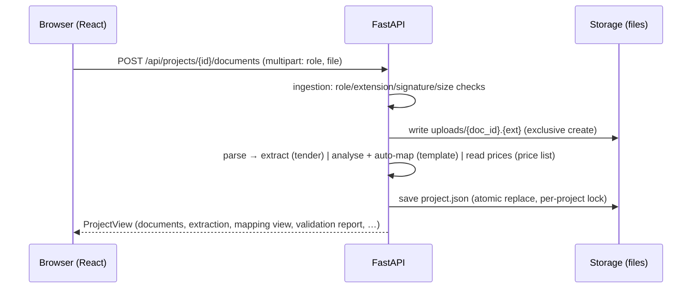

# System description

This document describes the system **as implemented** in version 0.1.0. Code organisation and design decisions
are in [ARCHITECTURE.md](ARCHITECTURE.md); data structures in [DATA_MODEL.md](DATA_MODEL.md).

## 1. Responsibilities

| Part | Responsibility |
|---|---|
| **Backend** (`backend/app`, FastAPI) | Owns every rule and every number: upload validation, storage, parsing, extraction, template analysis, mapping, quotation building, arithmetic, validation, instruction parsing, export and verification. Stateless between requests apart from files on disk. |
| **Frontend** (`frontend/src`, React SPA) | Presents state and collects decisions. It never computes totals or validation itself; after every mutation it renders the `ProjectView` returned by the backend. |
| **Storage** (`backend/data/`) | One folder per project: `project.json`, `uploads/`, `exports/`; plus `settings.json`. |

## 2. Request / response flow

- Every mutating route loads the project under a per-project lock (`ProjectStore.transaction`), applies the change,
  saves atomically (temp file + `os.replace`) and returns the full `ProjectView`. If anything raises, nothing is saved.
- `ProjectView.validation` is recomputed on every read once a quotation exists (it is `null` before), so the UI can
  never show a stale "ready" state.
- Errors are JSON: `{"error": {"code": "...", "message": "..."}}` with an appropriate status (400/404/409/413/415/422/500).
  Messages are written for end users and never include paths, stack traces or environment values.
- Every response carries `X-Content-Type-Options`, `X-Frame-Options`, `Referrer-Policy` and a strict
  `Content-Security-Policy` (FastAPI's `/docs` page excepted) — see [SECURITY_PRIVACY.md](SECURITY_PRIVACY.md).

### Implemented routes

| Method & path | Purpose |
|---|---|
| `GET /api/health` | Status, version, AI mode (secret-free), PDF availability, limits, currencies |
| `GET/PUT /api/settings` | Company profile, default currency, tax, number prefix, AI opt-in |
| `POST /api/demo/project` | Create the sample project by running the sample files through the normal pipeline |
| `DELETE /api/data?confirm=DELETE` | Delete all projects, files and settings |
| `GET/POST /api/projects` | List summaries / create a project |
| `GET/PATCH/DELETE /api/projects/{id}` | Full project view / rename / delete with files |
| `POST /api/projects/{id}/documents` | Upload (`role` = tender, template, price_list) |
| `POST /api/projects/{id}/samples` | Load the sample documents into this project |
| `DELETE /api/projects/{id}/documents/{doc}` | Remove a document (and what was derived from it) |
| `GET …/documents/{doc}/download` | Original file, unchanged |
| `GET …/documents/{doc}/evidence?block_id=&page=` | Verbatim text around a source reference |
| `POST …/documents/{doc}/reuse` | New project with a copy of this template |
| `PUT /api/projects/{id}/extraction` | Review actions: confirm / edit / choose candidate / unconfirm / clear; line items; requirements; mark reviewed |
| `POST …/extraction/confirm-all` | Confirm every value with status *extracted* (not conflicts or needs-review) |
| `PUT /api/projects/{id}/mapping` · `POST …/mapping/confirm` | Change rows / confirm the mapping |
| `POST …/quotation/generate` | Build (or rebuild) the quotation — requires a confirmed mapping |
| `PUT …/quotation` | Manual edits as structured operations |
| `POST …/quotation/undo` | Restore the previous snapshot |
| `POST …/quotation/edits` | Natural-language instruction → proposal (or an explanation) |
| `POST …/quotation/edits/{edit}/apply` · `…/cancel` | Apply (with `confirm_material`) or cancel a proposal |
| `POST …/quotation/fix` | Quick fixes offered by validation |
| `POST …/validation/acknowledge` | Acknowledge / re-open a warning |
| `POST …/export` · `GET …/exports/{exp}/download` · `DELETE …/exports/{exp}` | Export, download, delete |
| `GET …/preview/docx` · `GET …/preview/xlsx` | Draft rendered into the template (not stored) |
| `GET /api/library/templates · documents · activity` | Cross-project listings |

Compared with the routes suggested in the product brief: extraction and validation are part of `GET /api/projects/{id}`
(validation is always recomputed) instead of separate `GET …/extraction` and `POST …/validate` routes.

## 3. Pipeline

### Stage 1 — Ingestion (`app/ingestion.py`)
Role allow-list (tender: PDF/DOCX; template: DOCX/XLSX; price list: XLSX/CSV) → extension check with helpful
messages for legacy formats → size limit (`TENDERFLOW_MAX_UPLOAD_MB`, also checked against `Content-Length`) →
non-empty → content checks: `%PDF-` header; for DOCX/XLSX a valid zip with `[Content_Types].xml` and the main part,
≤ 5 000 entries and ≤ 300 MB uncompressed (zip-bomb guard); CSV must decode as UTF-8/Windows-1252 without NUL bytes.
The file is written to `uploads/{doc_id}.{ext}` with exclusive create (`open(..., "xb")`). The sanitised original
filename is display metadata only. If parsing then fails, the stored file is deleted and the error returned.

### Stage 2 — Parsing (`app/parsing/`)
- **PDF** (pdfplumber): per page, ruled tables via `find_tables()`; characters inside table boxes are excluded from
  the text, remaining lines are grouped into paragraphs (continuation lines merged). Blocks carry `page` and first
  `line`. Pages with images but no text are reported as scanned (no OCR). Encrypted/broken PDFs → clear errors.
- **DOCX** (python-docx): body paragraphs and tables in document order; paragraph numbers and table/row indexes;
  merged cells de-duplicated.
- **XLSX/CSV** (openpyxl / csv): each non-empty row is a block with sheet name and cell references.

### Stage 3 — Structured extraction (`app/extraction/`)
- 16 field specifications (reference, title, issuer, address, issue date, deadline, bid opening, bid validity,
  delivery period/location, payment terms, warranty, bid security, currency, tax instructions, contact) matched by
  label regexes (`Label: value`, label cell + value cell) and a few sentence rules (e.g. *“submission deadline of …”*).
- Values are normalised where possible (dates → ISO, durations → days, currency → ISO code). Distinct normalised
  values for one field → **conflict** with every candidate and its source; the value stays empty until the user chooses.
- Weak heuristics (issuer from a heading, address from the line below it) produce **needs review**, never *extracted*.
- Line items from tables whose header has description + quantity columns; continuation tables on the next page are
  joined; non-numeric quantities are flagged; duplicated items with different quantities become conflicts.
- Requirement sentences (*shall / must / required*) are listed by category (eligibility, submission, …).
- The instruction-like-text detector flags passages such as *“ignore all previous instructions”*; they are reported
  and excluded from requirements but never acted on.

### Stage 4 — Review (`app/review.py`)
The user confirms, edits, chooses a conflict candidate, adds/removes line items, ticks requirements and marks the
extraction reviewed. Statuses stay distinct: `extracted`, `needs_review`, `conflict`, `missing`, `confirmed`, `edited`.

### Stage 5 — Template analysis and mapping (`app/template_analysis.py`, `app/mapping.py`)

#### Template conventions
- Placeholders `{{key}}` (optional: `{{key?}}`) in DOCX paragraphs, tables, headers/footers (including first/even
  page variants) or XLSX cells. Recognised keys are the 27 canonical quotation fields in `app/fields.py`
  (`company_name`, `quotation_number`, `tender_reference`, `buyer_name`, `delivery_terms`, `subtotal`, `total`, …).
  Unknown placeholders are listed and can be mapped manually.
- Items table: a header row (within the first three rows of a table, or any row of a sheet) with a description column
  and at least one of quantity / unit price / amount. The next row is the row repeated for each line item; its
  formatting is copied. Alternatively, a row containing `{{item.description}}`, `{{item.quantity}}`, … placeholders.
- Label blanks: a paragraph `Label: ______` / `Label: .....`, or a table row/sheet row with a recognised label followed
  by an empty cell (for totals, the last empty cell of the row).
- `signature` (labels such as *Signature*, *Stamp*) is detected but never filled.

Automatic mapping uses exact canonical keys only. Mapping rows are keyed by destination; changing any row clears the
confirmation. Generation requires a confirmed mapping.

### Stage 6 — Quotation generation (`app/quotation.py`)
- Company fields come only from Settings (or the sample project's fictional profile).
- Buyer/tender fields come from the extraction (unconfirmed values are marked).
- Commercial terms: the tender's stated requirement is proposed and marked **unconfirmed** (a quotation is a
  commitment); otherwise the user's default terms from Settings; otherwise missing.
- Generated by TenderFlow and labelled *calculated*: title “Quotation”, number `PREFIX-YYYYMMDD-XXXX`, today's date,
  and *valid until* (= validity days from bid opening or the quotation date, only when a duration is known).
- Currency only from Settings; tax only if configured. Never assumed.
- Line items from the extraction; unit prices only from the user's price list (exact name match → confirmed; partial
  match → needs confirmation; no or ambiguous match → missing).
- Arithmetic (`recalculate`): `amount = quantity × unit_price` (or the user's override), `Decimal`, ROUND_HALF_UP to
  2 dp. Subtotal only when **every** line has an amount; tax = subtotal × rate / 100 when enabled; total = subtotal + tax.

### Stage 7 — Natural-language editing (`app/editing/`)
1. `parse_instruction` (rules) maps an instruction to structured operations — or returns an explanation
   (“Total is calculated automatically”, “There is no item 9”). Unknown → “not understood” with examples.
2. If an AI provider is configured **and** enabled in Settings, unknown instructions go to the adapter, whose JSON is
   validated (see [AI_POLICY.md](AI_POLICY.md)).
3. A proposal is computed on a copy of the quotation and diffed field-by-field, including consequential total changes.
4. Material changes (prices, quantities, amounts, items, currency, tax, commercial commitments, total) require
   `confirm_material: true`. Proposals are bound to the quotation version and rejected if it changed meanwhile.
5. Applying pushes an undo snapshot (max 30) and records the change in the edit history. Manual edits use the same
   operations and code path.

Operations: `set_field`, `set_item`, `add_item`, `remove_item`, `set_currency`, `set_tax`, `highlight_missing`
(UI only), `confirm_fields` and `confirm_prices` (manual only, never accepted from AI).

### Stage 8 — Validation (`app/validation.py`)
19 rules run on every read: mapping confirmed · required template fields have data · extraction confirmed ·
unresolved conflicts · line items present · item values (missing/negative/zero) · amount = qty × price ·
subtotal/tax/total consistency · currency selected / matches tender · tax decision · price-list matches confirmed ·
commercial commitments confirmed · quantity vs tender · tender items quoted / items added · delivery and validity vs
tender requirements · deadline passed / within 48 h · unverified claims and AI-suggested wording · eligibility
reminder · instruction-like text notice.

Errors cannot be acknowledged; warnings can (and stay listed as acknowledged). `ready` = no errors and no
unacknowledged warnings. A rule "passes" when it raised no error or warning.

### Stage 9 — Export (`app/export/`)
- The stored template is opened and saved to a new file; the original is hashed before and after.
- DOCX: placeholders replaced inside the existing runs (multi-run placeholders merged into the first run's
  formatting); label blanks filled; the items row cloned per line item; draft exports get a one-line DRAFT banner.
- XLSX: placeholder cells filled (whole-cell numeric placeholders written as numbers); items written into the rows
  under the header — rows are inserted (style copied) when there is not enough room; drafts get a DRAFT print header.
- Missing required values are written as `[MISSING: Label]`; nothing is left silently blank.
- PDF: the filled DOCX/XLSX is converted with `soffice --headless --convert-to pdf` using a temporary profile.
- Verification: the file is re-opened with the matching parser; checks (no leftover placeholders, tender reference and
  total present, all line items written, missing values marked, template unchanged) are stored with the export.
- Final exports require `ready`; drafts are always allowed and carry `_DRAFT` in the filename.

## 4. Error handling

Expected failures raise `AppError(code, message, status)`; validation errors from FastAPI are reformatted to the same
shape; unexpected exceptions return a generic 500 and log only the exception type (messages could contain document
text). The frontend shows backend messages in toasts or inline notices and reports an unreachable backend explicitly.

## 5. Local demo mode

The default mode needs no keys or network access: all processing is rule-based and local. `POST /api/demo/project`
loads the fictional files from `samples/` through the normal upload pipeline. Fonts and icons are bundled, so the UI
works offline.

## 6. External AI boundary

Only `app/ai/` talks to a model, only for unrecognised edit instructions, and only when configured via environment
variables **and** enabled in Settings. Details and the exact data sent: [AI_POLICY.md](AI_POLICY.md).

## 7. Configuration and deployment assumptions

- Single user, single process (`uvicorn`), on the user's own computer (`localhost`). No authentication.
- Configuration via `TENDERFLOW_*` environment variables or a root `.env` file (see README).
- In development the Vite server proxies `/api`; in demo mode the backend serves `frontend/dist`.
- LibreOffice is optional and detected at runtime (`TENDERFLOW_SOFFICE_PATH`, `PATH`, common install paths).
